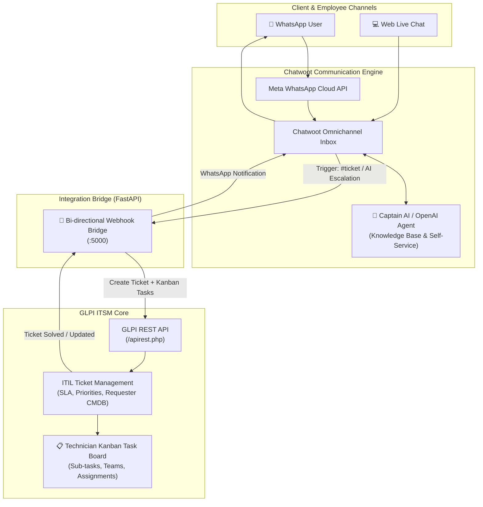

# IT Ticketing & Task Management with Chat Support & WhatsApp AI Integration

An enterprise-ready, open-source stack combining:
1. **GLPI**: ITIL Ticketing, CMDB Asset Inventory, and Technician Kanban Task Boards.
2. **Chatwoot**: Live Chat Portal, Meta WhatsApp Business API integration, and Captain AI / OpenAI automated triage.
3. **Integration Bridge**: Real-time bidirectional webhook sync between WhatsApp/Chatwoot threads and GLPI ITIL Tickets & Tasks.

---

## 🏛️ Architecture Overview



---

## 🚀 Quick Start Guide

### Prerequisites
- [Docker](https://docs.docker.com/get-docker/) & [Docker Compose](https://docs.docker.com/compose/)
- Git

### 1. Clone & Configure Environment
Copy `.env.example` to `.env`:
```bash
cp .env.example .env
```
Key configuration settings in `.env`:
- `GLPI_PORT`: GLPI web portal port (default: `8080`)
- `CHATWOOT_PORT`: Chatwoot web portal port (default: `3000`)
- `OPENAI_API_KEY`: Your OpenAI API Key for Captain AI triage
- `BRIDGE_SECRET_TOKEN`: Shared secret token for webhook verification

### 2. Automatic Initialization & Startup
#### On Windows (PowerShell):
```powershell
.\setup.ps1
```

#### On Linux / macOS:
```bash
chmod +x setup.sh
./setup.sh
```

The setup script:
1. Configures the environment.
2. Prepares Chatwoot PostgreSQL database tables (`db:chatwoot_prepare`).
3. Builds and boots all services:
   - **GLPI ITSM**: [http://localhost:8080](http://localhost:8080)
   - **Chatwoot Dashboard**: [http://localhost:3000](http://localhost:3000)
   - **Bridge Service**: [http://localhost:5000/health](http://localhost:5000/health)

---

## ⚙️ Configuration Manual

### Step 1: GLPI Initial Setup & REST API Activation

1. **Complete Web Wizard**:
   - Navigate to `http://localhost:8080`.
   - Select your language, accept the license, choose **Install**.
   - Database Connection parameters:
     - **Database Host**: `glpi-mariadb`
     - **User**: `glpi`
     - **Password**: `glpi_secure_pwd_123` (or the value set in `.env`)
     - **Database**: `glpidb`
   - Default administrator credentials:
     - Username: `glpi`
     - Password: `glpi` *(remember to change this upon first login)*.

2. **Enable GLPI REST API**:
   - Go to **Setup** > **General** > **API** tab.
   - Set **Enable REST API** to `Yes`.
   - Set **Enable login with external token** to `Yes`.
   - Click **Add API client**:
     - Name: `Chatwoot Bridge`
     - Active: `Yes`
     - Click **Regenerate** on **Application token (app_token)**.
     - Copy this token and paste it into `.env` as `GLPI_APP_TOKEN`.

3. **Generate User Token**:
   - Go to **Administration** > **Users** > select `glpi` (or an IT technician user).
   - Go to the **Remote access keys** / **API Token** section.
   - Click **Regenerate** under **Personal token (user_token)**.
   - Copy this token and paste it into `.env` as `GLPI_USER_TOKEN`.

4. **Restart the Bridge Container**:
   ```bash
   docker-compose restart bridge
   ```

---

### Step 2: Chatwoot WhatsApp Business API Setup

1. **Log in to Chatwoot**:
   - Navigate to `http://localhost:3000`.
   - Create your Super Admin account on first launch.

2. **Add WhatsApp Inbox**:
   - Go to **Settings** > **Inboxes** > **Add Inbox**.
   - Select **WhatsApp** (Cloud API).
   - Provide your Meta Developer credentials:
     - **Phone Number ID** (from Meta WhatsApp Developer Dashboard).
     - **WhatsApp Business Account ID (WABA ID)**.
     - **Permanent Access Token** with `whatsapp_business_messaging` permissions.
   - Set the Webhook Callback URL and Verify Token in your Meta Developer App as instructed by Chatwoot.

3. **Add Live Chat Widget (Optional)**:
   - In **Settings** > **Inboxes** > **Add Inbox**, choose **Website Channel**.
   - Copy the JavaScript snippet to embed live chat on your internal intranet, employee self-service portal, or company website.

---

### Step 3: Chatwoot AI Integration (Captain AI / OpenAI)

1. **Activate OpenAI / Captain in Chatwoot**:
   - Ensure `OPENAI_API_KEY` is specified in `.env`.
   - Go to **Settings** > **Integrations** > **OpenAI**.
   - Hook your OpenAI key and configure features:
     - *Reply Suggestions*: Suggested answers based on past tickets.
     - *Conversation Summarization*: Synthesizes long user discussions into concise bullet points.
     - *Rephrase & Fix Grammar*: Formats professional responses.

2. **Captain AI & Knowledge Base**:
   - In Chatwoot, navigate to **Help Center** / **Portals**.
   - Upload IT self-service troubleshooting guides (e.g., VPN setup, password resets, Wi-Fi connectivity, printer drivers).
   - Configure Captain AI to triage conversations first. If the user indicates the issue remains unresolved, Captain can append the label `ticket-needed`, automatically triggering the Bridge to create a GLPI ticket!

---

### Step 4: Configure Chatwoot Webhook to Bridge

1. In Chatwoot, navigate to **Settings** > **Integrations** > **Webhooks** > **Add Webhook**.
2. Set the Webhook URL:
   - For container-to-container inside Docker network: `http://bridge:5000/webhook/chatwoot`
   - (Or if using host networking: `http://<YOUR_SERVER_IP>:5000/webhook/chatwoot`)
3. Select subscriptions:
   - `Message Created`
   - `Conversation Created`
   - `Conversation Updated`

---

## 🛠️ IT Task Matrix & GLPI Kanban Boards

GLPI features native Kanban boards to manage IT tasks across multiple teams:

1. **Accessing the Kanban Board**:
   - Go to **Assistance** > **Tickets**.
   - In the top right corner, switch the view from **List** to **Kanban (Global)** or **Personal Kanban**.
   - Columns automatically group tickets by state:
     - `New` (Unassigned incoming requests)
     - `Assigned` (Technician assigned, in progress)
     - `Planned` (Scheduled maintenance or planned interventions)
     - `Pending` (Awaiting vendor or user feedback)
     - `Solved` (Technician completed work)
     - `Closed` (Confirmed and closed)

2. **Decomposing Issues into Sub-Tasks**:
   - When the Bridge creates a GLPI Ticket from WhatsApp, it automatically inserts an initial task: `Initial Triage & Diagnostics`.
   - Open any Ticket > click **Tasks** tab.
   - Add granular sub-tasks, such as:
     - *Network team: Check firewall whitelist*
     - *SysAdmin: Reset Active Directory account lockout*
     - *Hardware team: Dispatch replacement docking station*
   - Sub-tasks have individual duration timers, status (`To do`, `In progress`, `Done`), and assignee technicians.

---

## 🧪 Testing the End-to-End Workflow

1. **User opens WhatsApp** and sends a message:
   > *"Hello, our warehouse barcode scanner is not connecting to the local Wi-Fi network."*

2. **Chatwoot AI responds**:
   > Provides knowledge base steps (check SSID, reboot device).

3. **Escalation to Technician**:
   - Either the user replies: *"That didn't fix it, please dispatch IT"* or types `#ticket`.
   - Or the agent/AI applies the label `ticket-needed`.

4. **Automatic GLPI Ticket Generation**:
   - The Bridge microservice creates Ticket `#101` in GLPI with the user's WhatsApp number, name, and chat transcript.
   - A sub-task is automatically placed on the GLPI Kanban board.
   - Chatwoot posts an internal note with the direct GLPI ticket link.
   - WhatsApp user receives instant confirmation:
     > *"🎫 Hello! Your request has been logged in our IT Management System. Ticket Number: #101. An IT technician is investigating."*

5. **Resolution & Feedback**:
   - Technician moves the ticket to **Solved** on GLPI Kanban and adds resolution notes.
   - GLPI webhook triggers the Bridge, which sends an update directly back to the user on WhatsApp.

---

## 📁 Repository Structure

```
TICKET-Managment-System/
├── docker-compose.yml        # Multi-container orchestration (GLPI, Chatwoot, MariaDB, Postgres, Redis, Bridge)
├── .env.example              # Environment variables template
├── setup.ps1                 # Windows automated deployment script
├── setup.sh                  # Linux/macOS automated deployment script
├── README.md                 # System architecture and manual
└── bridge/                   # Fast-API Integration Microservice
    ├── Dockerfile            # Python 3.11 container definition
    ├── requirements.txt      # FastAPI, Uvicorn, HTTPX dependencies
    ├── config.py             # App configuration & environment loader
    ├── glpi_client.py        # GLPI REST API client (Tickets & Kanban Tasks)
    ├── chatwoot_client.py    # Chatwoot REST API client (WhatsApp messages & tags)
    └── main.py               # Bi-directional Webhook handlers & background workers
```
