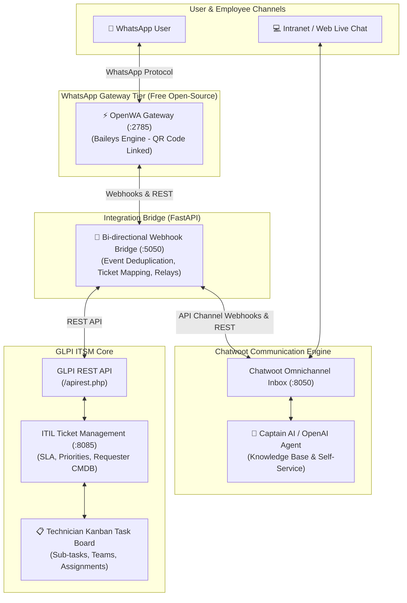

# IT Ticketing & Task Management with Chat Support & WhatsApp AI Integration

An enterprise-grade, open-source stack combining:
1. **GLPI ITSM Core**: ITIL processes, CMDB asset inventory, and technician Kanban task boards.
2. **Chatwoot**: Live chat portal, Captain AI / OpenAI automated triage, and omnichannel team inbox.
3. **OpenWA Gateway**: 100% free, open-source WhatsApp API Gateway (no paid Meta Cloud API, no credit card, QR code linked).
4. **Integration Bridge**: Real-time bi-directional FastAPI webhook bridge synchronizing WhatsApp messages, Chatwoot threads, and GLPI ITIL Tickets & Tasks.

---

## 📚 Complete Documentation Library

| Documentation Guide | Description |
| :--- | :--- |
| **[Daily Usage & Operations Guide](docs/USAGE_GUIDE.md)** | How to use WhatsApp AI, Chatwoot Live Chat, and GLPI Kanban in daily operations. |
| **[Installation & Setup Guide](docs/INSTALLATION_GUIDE.md)** | Step-by-step instructions to deploy and configure on your server. |
| **[System Architecture & Data Flow](docs/ARCHITECTURE.md)** | Architectural blueprints, sequence diagrams, network topology, and component deep dives. |
| **[API Reference & Webhooks](docs/API_REFERENCE.md)** | Full REST API endpoints, request/response JSON schemas, and webhook specs. |
| **[OpenWA WhatsApp QR Guide](docs/OPENWA_SETUP_GUIDE.md)** | How to link any WhatsApp phone number in 10 seconds via QR code. |
| **[GLPI Plugins & Permissions Guide](docs/GLPI_PLUGINS_GUIDE.md)** | How to install, fix permissions, and manage GLPI plugins in Docker containers. |
| **[Automated Notifications & 30s CLI Cron](docs/AUTOMATED_NOTIFICATIONS_GUIDE.md)** | Setup 30-second automated notification processing and email queues via CLI. |
| **[Captain AI IT Support Prompt](docs/CAPTAIN_AI_PROMPT.md)** | Production system prompt for Tier-1 IT Support triage in Chatwoot. |
| **[Meta WhatsApp Templates](docs/META_WHATSAPP_TEMPLATES.md)** | Pre-written templates if you ever choose to migrate to official Meta Cloud API. |

---

## 🏛️ System Architecture



---

## 🌐 Network Ports Table

| Service | Internal Port | Host Port | URL Endpoint | Description |
| :--- | :--- | :--- | :--- | :--- |
| **GLPI ITSM** | `80` | **`8085`** | `http://<SERVER_IP>:8085` | Web portal, Kanban task board, REST API |
| **Chatwoot Web** | `3000` | **`8050`** | `http://<SERVER_IP>:8050` | Agent inbox, Live chat widget, AI settings |
| **OpenWA Gateway** | `2785` | **`2785`** | `http://<SERVER_IP>:2785` | WhatsApp QR Code Dashboard & REST API |
| **Integration Bridge**| `5000` | **`5050`** | `http://<SERVER_IP>:5050/health`| FastAPI Webhook router & data synchronizer |

*All databases (MariaDB 10.11, PostgreSQL 15, Redis) are isolated inside the internal Docker bridge network (`it-network`).*

---

## ⚡ Quick Deployment (Single Command)

### On Server:
```bash
# 1. Clone repository to target directory
mkdir -p /home/ubuntu/Ticket_Managment_System_Webserver
cd /home/ubuntu/Ticket_Managment_System_Webserver
git clone https://github.com/sainisoftravi/GLPI_Chatwot_Ticket.git .

# 2. Run automated setup
chmod +x setup.sh
./setup.sh
```

---

## 🔄 How the End-to-End Workflow Works

1. **User asks question on WhatsApp**:
   - Sends a message to your WhatsApp number.
   - OpenWA forwards it to the Bridge, which injects it into Chatwoot.
2. **AI First-Line Defense**:
   - Captain AI searches your IT documentation and replies with troubleshooting steps.
3. **Escalation to ITIL Ticket**:
   - If user replies `#ticket` (or agent adds label `ticket-needed`):
   - Bridge automatically creates an ITIL Ticket in GLPI with requester info and chat history.
   - An initial diagnostic sub-task is automatically placed on the GLPI Kanban board.
   - User gets an immediate confirmation on WhatsApp: *"🎫 Hello! Your request has been logged as Ticket #101. An IT technician is investigating."*
4. **Technician Resolution**:
   - Technician drags ticket to **Solved** on GLPI Kanban and adds resolution notes.
   - GLPI webhook triggers Bridge, which relays the resolution back to the customer on WhatsApp.

For full step-by-step configuration, see the **[Installation Guide](docs/INSTALLATION_GUIDE.md)**.
