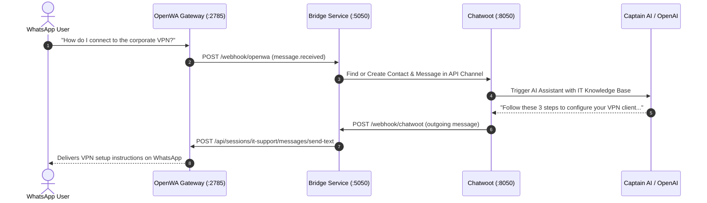
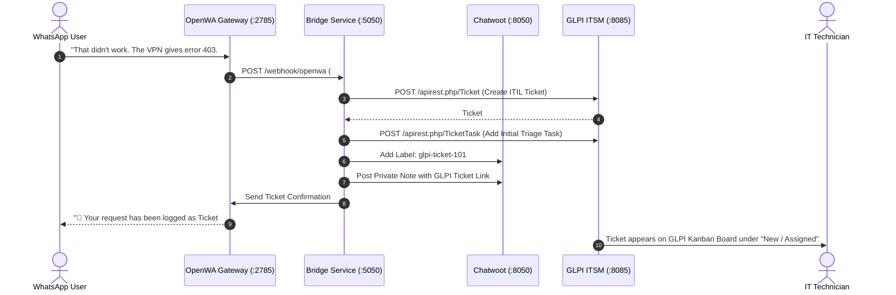
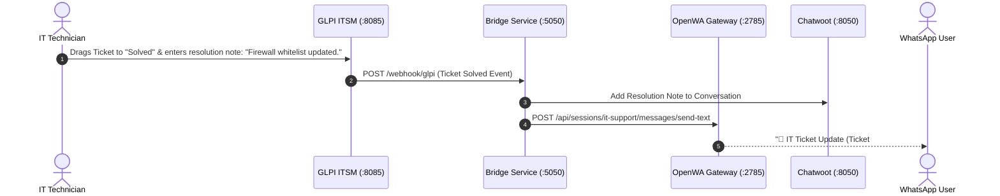

# 🏛️ System Architecture & Data Flow

This document details the architectural design, component interactions, network topology, and sequence workflows for the **IT Ticket and Task Management System with Chatwoot & OpenWA WhatsApp Integration**.

---

## 1. High-Level System Architecture

```mermaid
flowchart TD
    subgraph Client_Tier ["1. User & Client Interface Tier"]
        WA_USER["📱 WhatsApp User (Employee / Client)"]
        WEB_USER["💻 Intranet / Web Portal User"]
    end

    subgraph Messaging_Tier ["2. WhatsApp Gateway Tier (Free Open-Source)"]
        OPENWA["⚡ OpenWA Gateway (:2785)\nEngine: Baileys WebSocket\n(Zero-Cost QR Code Link)"]
    end

    subgraph Chatwoot_Tier ["3. AI & Omnichannel Communication Tier"]
        CW_WEB["💬 Chatwoot Web Interface (:8050)"]
        CW_SIDEKIQ["⚙️ Sidekiq Background Worker"]
        CW_REDIS[("🔴 Redis Cache")]
        CW_PG[("🐘 PostgreSQL DB")]
        CW_AI["🤖 Captain AI / OpenAI Agent\n(Knowledge Base Self-Service)"]
    end

    subgraph Middleware_Tier ["4. Integration Bridge Tier (FastAPI)"]
        BRIDGE["🔄 Bi-Directional Webhook Bridge (:5050)\n- Message Ingestion & Normalization\n- Event Deduplication\n- ITIL Ticket & Task Mapping\n- Auto-dispatch to OpenWA"]
    end

    subgraph GLPI_Tier ["5. GLPI ITSM & Task Core Tier"]
        GLPI_APP["📋 GLPI ITSM Core (:8085)\n- ITIL Service Catalog\n- CMDB Asset Inventory\n- SLA Engine & Escalation Matrices"]
        GLPI_KANBAN["📊 Technician Kanban Board\n(Multi-Team Task Queues & Sub-Tasks)"]
        GLPI_DB[("🐬 MariaDB 10.11")]
    end

    %% Flow Connections
    WA_USER <-->|WhatsApp Protocol| OPENWA
    WEB_USER <-->|WebSocket / HTTPS| CW_WEB

    OPENWA <-->|Webhooks & REST| BRIDGE
    BRIDGE <-->|API Channel Webhooks & REST| CW_WEB
    CW_WEB <--> CW_SIDEKIQ
    CW_SIDEKIQ <--> CW_REDIS
    CW_WEB <--> CW_PG
    CW_WEB <--> CW_AI

    BRIDGE <-->|REST API (/apirest.php)| GLPI_APP
    GLPI_APP <--> GLPI_DB
    GLPI_APP <--> GLPI_KANBAN
```

---

## 2. End-to-End Sequence Workflows

### Sequence A: Inbound User Request & AI Auto-Triage



---

### Sequence B: Escalation & GLPI ITIL Ticket Creation

When self-service troubleshooting is insufficient, the issue escalates to an official ITIL ticket and Kanban task matrix:



---

### Sequence C: Technician Kanban Resolution & WhatsApp Callback



---

## 3. Network Architecture & Port Map

All containers reside on a shared internal Docker bridge network (`it-network`).

| Container Service | Image | Internal Port | Exposed Host Port | Network Scope | Purpose |
| :--- | :--- | :--- | :--- | :--- | :--- |
| `glpi-app` | `glpi/glpi:latest` | `80` | **`8085`** | Public / Host | GLPI Web UI, Technician Kanban & REST API |
| `glpi-mariadb` | `mariadb:10.11` | `3306` | *None* | Internal only | GLPI Database |
| `chatwoot-web` | `chatwoot/chatwoot:latest` | `3000` | **`8050`** | Public / Host | Chatwoot Web UI, API Channel & Live Chat |
| `chatwoot-worker`| `chatwoot/chatwoot:latest`| — | *None* | Internal only | Sidekiq Background Job Processor |
| `chatwoot-postgres`| `postgres:15-alpine` | `5432` | *None* | Internal only | Chatwoot Database |
| `chatwoot-redis` | `redis:alpine` | `6379` | *None* | Internal only | Chatwoot Cache & Job Queue |
| `openwa-gateway` | `ghcr.io/rmyndharis/openwa:latest` | `2785` | **`2785`** | Public / Host | OpenWA WhatsApp REST API & Web Dashboard |
| `it-integration-bridge` | `./bridge/Dockerfile` | `5000` | **`5050`** | Public / Host | Bi-directional Webhook Gateway |

---

## 4. Component Deep Dive

### 4.1. GLPI ITSM Core
- **ITIL Compliance**: Handles Incident Management, Service Request Fulfillment, Problem Management, and Change Management.
- **CMDB Asset Tracking**: Links incoming WhatsApp tickets to inventory assets (e.g. associating the user's phone number with their assigned laptop or department).
- **Kanban Task Matrix**: Breaks complex IT issues into sub-tasks (e.g. Level-1 Triage, Network Admin, Hardware Dispatch) with individual timers, assignees, and state tracking.

### 4.2. OpenWA WhatsApp Gateway
- **Zero-Cost Operation**: Does not use the paid Meta Cloud API. Emulates WhatsApp Multi-Device protocol via the `@whiskeysockets/baileys` WebSocket engine.
- **Multi-Session**: Can host multiple WhatsApp numbers simultaneously.
- **Embedded Dashboard**: Visual QR code scanner and session management at `http://<SERVER_IP>:2785`.

### 4.3. Chatwoot Communication Hub
- **Omnichannel Inbox**: Unifies WhatsApp messages, web live chat widgets, and email into a single dashboard.
- **Captain AI / OpenAI**: Scans ingested IT documentation to provide 24/7 autonomous Level-1 support.
- **API Channels**: Connects custom webhook bots without requiring third-party SaaS middle layers.

### 4.4. Integration Bridge Microservice
- **Written in Python 3.11 with FastAPI and HTTPX AsyncClient**.
- **Deduplication Engine**: In-memory ring buffer preventing duplicate ticket creation when webhooks retry.
- **State Transformer**: Maps unstructured WhatsApp text into structured ITIL Ticket payloads with Urgency, Category, Requester metadata, and Kanban sub-tasks.

