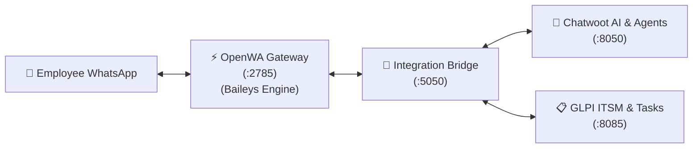

# 📱 OpenWA Integration Guide (Free Open-Source WhatsApp Gateway)

With **OpenWA**, you do not need a Meta Business Account, credit card, or official API approval. You can connect any phone number by scanning a QR code on your server.

---

## 🏗️ Architecture



---

## 🚀 Quick Setup (3 Steps)

### Step 1: Retrieve Your OpenWA Admin API Key
On first boot, OpenWA generates a secure API key inside its container volume:

```bash
docker exec openwa-gateway cat /app/data/.api-key
```

Copy the key output and add it to your server `.env`:
```ini
OPENWA_API_KEY=your_copied_api_key_here
```

Restart the bridge container:
```bash
docker compose restart bridge
```

---

### Step 2: Scan QR Code in OpenWA Dashboard
1. Open in your browser: `http://<SERVER_IP>:2785`
2. Sign in using the API Key retrieved in Step 1.
3. Under **Sessions**:
   - Click **Create Session**.
   - Session Name: `it-support` (matches `OPENWA_SESSION_NAME` in `.env`).
   - Engine: `baileys` (recommended: lightweight, 30–80MB RAM).
   - Click **Start Session**.
4. Click **Scan QR Code**:
   - Open WhatsApp on your support phone.
   - Go to **Linked Devices > Link a Device**.
   - Scan the QR code displayed on the screen.
5. Your WhatsApp number is now connected!

---

### Step 3: Configure Webhooks

#### 1. In OpenWA Dashboard:
- Go to **Webhooks** > **Add Webhook**:
  - **URL**: `http://bridge:5000/webhook/openwa`
  - **Events**: Check `message.received`
  - Click **Save**.

#### 2. In Chatwoot (`http://<SERVER_IP>:8050`):
- Go to **Settings > Inboxes > Add Inbox > API Channel**:
  - **Channel Name**: `WhatsApp OpenWA`
  - **Webhook URL**: `http://bridge:5000/webhook/chatwoot`
- Save the inbox. Note the created Inbox ID (default is `1`), which matches `CHATWOOT_INBOX_ID=1` in `.env`.

---

## 🧪 Testing the Live Workflow

1. From any phone, send a WhatsApp message to the connected number:
   > *"Hello! My laptop screen is flickering."*
2. **Chatwoot AI / Captain AI** immediately replies with diagnostic steps.
3. If the user replies:
   > *"It is still broken, please dispatch a technician #ticket"*
4. **GLPI** immediately:
   - Creates a new ITIL Ticket with the user's phone number and issue.
   - Places a sub-task on the technician Kanban board.
   - Replies to WhatsApp:
     > *"🎫 Hello! Your request has been logged in our IT Management System. Ticket Number: #101. An IT technician is investigating."*
