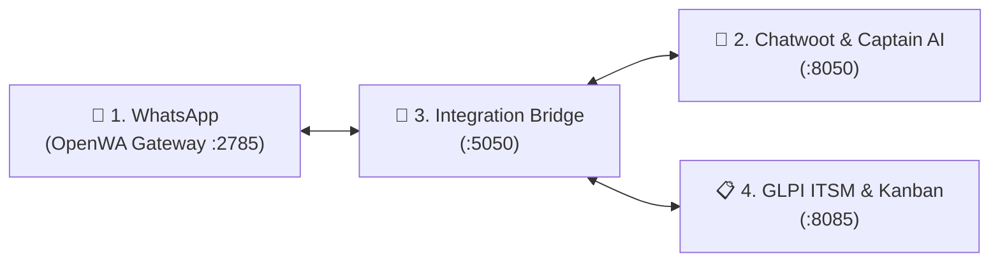

# 📖 Complete Usage & Operations Guide

This guide explains how to use the integrated **IT Ticketing, Task Management, Live Chat Support, and WhatsApp AI System** in daily operations.

---

## 🌟 The 4 Integrated Pillars



1. **OpenWA Gateway (`:2785`)**: Bridges personal or business WhatsApp numbers directly into your server via QR code without Meta API fees.
2. **Chatwoot (`:8050`)**: The unified inbox for support technicians and **Captain AI**, providing 24/7 automated troubleshooting.
3. **Integration Bridge (`:5050`)**: The intelligent broker that detects escalation commands, maps WhatsApp users to GLPI tickets, and manages two-way status relays.
4. **GLPI ITSM (`:8085`)**: The core engine for ITIL ticket workflows, CMDB asset inventories, technician matrices, and **Kanban Task Boards**.

---

## 🔄 Daily Operational Scenarios

### Scenario 1: Self-Service AI Assistance (24/7 Tier-1 Triage)

When an employee or client has a routine IT inquiry:

1. **User Action**: The employee sends a WhatsApp message to your connected support number:
   > *"How do I connect my laptop to the office Wi-Fi?"*
2. **OpenWA Ingestion**: OpenWA receives the message and pushes it to `http://bridge:5000/webhook/openwa`.
3. **Chatwoot Routing**: The Bridge creates a contact and opens a conversation thread in Chatwoot.
4. **AI Triage**: Chatwoot's **Captain AI** checks your uploaded Knowledge Base articles and replies:
   > *"To connect to the corporate Wi-Fi: 1. Select SSID 'Corp-Secure'. 2. Enter your domain credentials. 3. Accept the security certificate."*
5. **WhatsApp Delivery**: The Bridge relays this answer through OpenWA back to the user's WhatsApp.

---

### Scenario 2: Escalating an Issue to an Official ITIL Ticket

When an issue cannot be resolved by self-service and requires hands-on technician work:

#### Method A: User-Triggered Command (`#ticket`)
The user can type `#ticket` anywhere in their WhatsApp message:
> *"I tried the steps but my VPN gives error 403 authorization denied. #ticket"*

#### Method B: Agent-Triggered Label in Chatwoot
A technician monitoring Chatwoot can simply add the label **`ticket-needed`** to the conversation.

#### What Happens Automatically in the Background:
1. **Bridge Detection**: The Bridge detects the `#ticket` command or the `ticket-needed` label.
2. **GLPI Ticket Created**: The Bridge calls the GLPI REST API to create a new ticket:
   - **Title**: `IT Request from Sarah Connor: VPN gives error 403...`
   - **Content**: Includes the conversation transcript, requester name, and WhatsApp phone number.
   - **Category**: Set to default ITIL Category (e.g. *Network / VPN*).
   - **Status**: Set to `New (1)` or `Assigned (2)`.
3. **Sub-Task Generated**: The Bridge attaches an initial diagnostic sub-task to the ticket for the **Kanban Board**:
   - *Task: Initial Triage & Diagnostics (Auto-generated from WhatsApp AI Escalation)*
4. **Chatwoot Internal Note**: The Bridge posts an internal private note inside Chatwoot containing the direct link to the GLPI ticket:
   ```markdown
   ✅ GLPI ITIL Ticket Created
   - Ticket ID: #101
   - Kanban Status: Initial Triage (To Do)
   - GLPI Link: [Open Ticket #101](http://<SERVER_IP>:8085/front/ticket.form.php?id=101)
   ```
5. **WhatsApp Confirmation**: The user receives an automated acknowledgment directly on WhatsApp:
   > *"🎫 Hello! Your request has been logged in our IT Management System. Ticket Number: #101. An IT technician is investigating."*

---

### Scenario 3: Technician Task Management in GLPI (Kanban Board)

IT engineers and infrastructure teams manage the lifecycle of the ticket in GLPI:

1. **Accessing the Kanban Board**:
   - Open GLPI: `http://<SERVER_IP>:8085`.
   - Go to **Assistance** > **Tickets**.
   - In the top-right toolbar, toggle the view mode to **Kanban (Global)** or **Personal Kanban**.

2. **Kanban Status Columns**:
   - 📥 **New**: Newly arrived WhatsApp tickets awaiting triage.
   - 👨‍💻 **Assigned (Processing)**: Technician is actively working on the issue.
   - 📅 **Planned**: Scheduled interventions (e.g., *Server reboot scheduled for Saturday 2:00 AM*).
   - ⏳ **Pending**: Waiting on user or third-party vendor feedback.
   - ✅ **Solved**: Solution implemented by technician.
   - 🔒 **Closed**: Quality audit verified and ticket closed.

3. **Breaking Down Issues into Sub-Tasks (Task Matrix)**:
   - Click on Ticket `#101` to open the ticket details.
   - Click on the **Tasks** tab on the left.
   - Add granular sub-tasks for different teams:
     - *Task 1: Reset Active Directory user account (Assigned to: SysAdmin Team)*
     - *Task 2: Check Palo Alto firewall IP whitelist (Assigned to: Network Team)*
     - *Task 3: Test user tunnel connection (Assigned to: Helpdesk L1)*
   - Each task has its own status (`To do`, `In progress`, `Done`) and duration counter.

---

### Scenario 4: Resolving Tickets & Automated WhatsApp Resolution Updates

When the technician finishes the job:

1. In GLPI, the technician opens Ticket `#101`.
2. Go to the **Solution** tab:
   - Enter description: *"User Active Directory account was unlocked and firewall rules refreshed. VPN connectivity tested successfully."*
   - Change Status to **Solved**.
3. **Bridge Notification Relay**:
   - GLPI triggers the Bridge notification endpoint (`POST /webhook/glpi`).
   - The Bridge dispatches a message back to the customer's WhatsApp:
     > *"📢 IT Ticket Update (Ticket #101)\n\nStatus: Solved\nNotes: User Active Directory account was unlocked and firewall rules refreshed. VPN connectivity tested successfully.\n\nIf you have any further questions, simply reply here!"*
4. The user can reply to reopen the ticket or confirm that everything is working.

---

## 🛠️ Helpful Admin Tips & Configuration Best Practices

### 1. Matching OpenWA Session Name in `.env`
Ensure your server's `.env` matches the session name you created in the OpenWA Dashboard:
- If your session in OpenWA is named **`demo`**, set:
  ```ini
  OPENWA_SESSION_NAME=demo
  ```
- If your session is named **`it-support`**, set:
  ```ini
  OPENWA_SESSION_NAME=it-support
  ```
- Always restart the bridge after changing `.env`:
  ```bash
  docker compose restart bridge
  ```

### 2. Live Chat Support on Your Website or Intranet
In addition to WhatsApp, you can embed the live chat widget on your company intranet or internal employee portal:
1. In Chatwoot (`http://<SERVER_IP>:8050`), go to **Settings > Inboxes > Add Inbox > Website Channel**.
2. Copy the generated `<script>` widget snippet and paste it into the HTML of your intranet.
3. Employees can now chat either via WhatsApp or directly in their browser; both feed into the same Chatwoot inbox and GLPI ticketing pipeline!

### 3. Monitoring System Logs in Real Time
```bash
cd /home/ubuntu/Ticket_Managment_System_Webserver

# Watch live incoming WhatsApp & Bridge events
docker compose logs -f bridge

# Watch Chatwoot background workers
docker compose logs -f chatwoot-worker

# Watch OpenWA gateway activity
docker compose logs -f openwa
```
